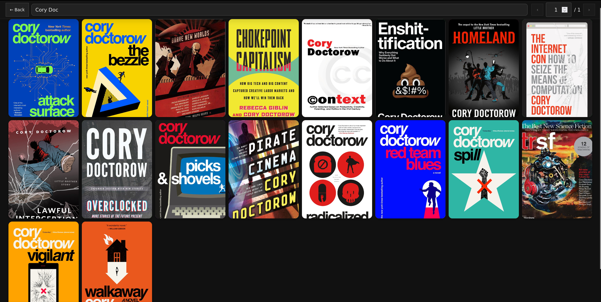
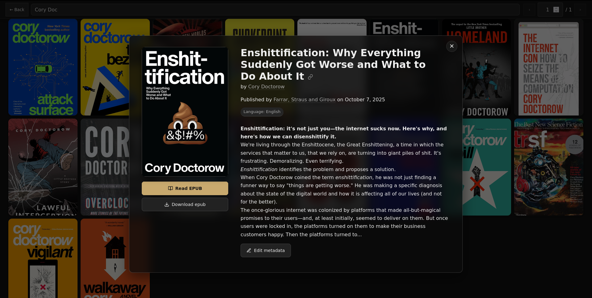

# CalibreFast

A fast, minimal web frontend for your [Calibre](https://calibre-ebook.com/) library.

> ⚠️ **Experimental.** CalibreFast is not feature complete and comes with no security guarantees. **Do not expose it to the public internet**. It is intended for personal use on a trusted local network (e.g. private wireguard/tailscale network).
>
> 🔒 **Accounts are new and haven't been independently reviewed.** Only admins can change the library, and only when the server is started with `-allow-writes`. Read [SECURITY.md](docs/SECURITY.md) before exposing CalibreFast beyond your own machine.




---

## Is this AI Slop?

Perhaps. This project is built with AI assistance, and I audit and test much of the non-boilerplate code by hand. See [AI-DISCLOSURE.md](docs/AI-DISCLOSURE.md) for the full disclosure.

## What it is

CalibreFast is a personal project of mine, and I built it to scratch my own itch. I wanted a fast, simple way to browse my longstanding Calibre library without the slow performance of interfaces like Calibre-web or high resource usage of Booklore. 

CalibreFast reads directly from your Calibre `metadata.db` and serves your library as a snappy, paginated grid. Pages are pre-generated as static JSON at startup so browsing feels instant — no database round-trips while you scroll.

## Features

- **Fast browsing.** Scroll your whole library in one grid, or jump straight to any page.
- **Book details.** A popup for each book with read and download buttons for every format (EPUB, PDF, MOBI, AZW3, DJVU).
- **Read in the browser:** EPUB and PDF readers.
- **Search** by title or author.
- **Browse by author, publisher, tag or language,** with language codes shown as names (`eng` → English).
- **Groups** merge values that mean the same thing, like `en`/`eng`/`en-US` → English, without editing any books.
- **Metadata editor:** tag and language chips, autocomplete from your library, a formatted description editor, side-by-side comparison of your changes, and safeguards so curated metadata isn't lost. It can find ISBNs in the book's own files and look books up by ISBN on Open Library and Wikidata (Google Books on request), offering their metadata to pick from or accept in one go.
- **Uploads:** EPUB/PDF metadata is read automatically, and multiple formats of one book are combined.
- **Watch folder:** books dropped into a folder wait in a review queue. An admin checks the metadata (with ISBN lookups), chooses the cover, then adds each one to the library.
- **Accounts:** username/password, or GitHub/Google sign-in. Admins manage users, and can send someone a one-time sign-in or invite link (e.g. over Discord).
- **Favorites and reading status:** star books, and track what you want to read, are reading and have finished, straight from the covers in the grid. The readers update this as you go, and a cover's ▶ picks up where you left off.
- **Resume anywhere:** your reading position and bookmarks sync between devices, and are kept locally too in case the server is down.
- **KOReader sync:** use CalibreFast as KOReader's progress sync server, so positions follow you between your Kobo, Kindle or phone and the web readers.
- **Bookshelves:** your own private shelves, plus global shelves that admins curate for everyone.

Everything needs an account unless you open the catalog with `-public` (or reading too, with `-public-read`). Editing metadata, uploads and creating groups need an admin account and the `-allow-writes` flag.

See [docs/FEATURES.md](docs/FEATURES.md) for the details.

## What it is not

- Not production ready
- Not hardened or audited for the public internet — see [SECURITY.md](docs/SECURITY.md)
- Not a full Calibre replacement or sync tool

## Getting started

Requires Go 1.25+ and a Calibre library with a `metadata.db`.

**Starting from nothing?** CalibreFast doesn't create libraries itself: the database format belongs to Calibre, so let Calibre make it and every Calibre tool and front end can read it. Either open Calibre and choose a new, empty folder as the library, or use Calibre's command line:

```bash
calibredb --library-path /path/to/new/library list
```

That creates an empty library (`metadata.db` and all) in that folder. Point `-basedir` at it.

```bash
git clone https://github.com/iotku/CalibreFast.git
cd CalibreFast
go build .

# Create the first admin (prompts for a password, min. 10 characters)
./CalibreFast -create-user yourname -admin

# Run
./CalibreFast -basedir /path/to/calibre/library -cachedir /path/to/cache
```

Then open [http://localhost:8080](http://localhost:8080) and sign in. Add more users from **Account → Manage users**, or with `-create-user`. Running `-create-user` again for an existing name resets that user's password.

| Flag | Description |
|------|-------------|
| `-basedir` | Path to your Calibre library root (required) |
| `-cachedir` | Where to store cover thumbnails (default: the current directory) |
| `-port` | Port to listen on (default `8080`) |
| `-datadir` | Where CalibreFast keeps its own database: accounts, favorites, progress, shelves (default `./data`) |
| `-allow-writes` | Let **admins** edit metadata, upload, change covers and manage groups. Off by default. |
| `-watch-dir` | A folder to watch for new books. The system reports changes to it (checked every 30 seconds where it can't). Books are moved out of it into a review queue (`/import`) and only join the library when an admin adds them. Needs `-allow-writes`; must not be inside the library or `-datadir`. |
| `-watch-dir-force-polling` | Check `-watch-dir` every 30 seconds instead of waiting for the system to report changes. For folders on network or container mounts (NFS, SMB, some bind mounts) where new books aren't noticed. |
| `-public` | Let anyone browse the catalog without signing in. **By default the whole library is private:** nothing (not even covers or book IDs) is shown until you sign in. |
| `-public-read` | Public read-only mode: anyone can also read and download books (implies `-public`) |
| `-allow-registrations` | Let anyone create an account from the sign-in page. **Bots will try to sign up:** only use on a trusted network, such as a Tailscale network shared with people you trust. |
| `-public-url` | Your external URL, e.g. `https://books.example.com` (needed for GitHub/Google sign-in) |
| `-no-lookups` | Never look books up online: hides the metadata editor's ISBN lookup. Lookups are on by default but only happen when an admin clicks **Look up**. |
| `-no-google-books` | Never offer Google Books in the metadata editor. Open Library and Wikidata still work. |
| `-create-user NAME` | Create a user (or reset their password) and exit; add `-admin` to make them an admin |

GitHub and Google sign-in are optional: see [OAUTH.md](docs/OAUTH.md) for step-by-step setup.

Google Books is only asked when an admin clicks **Try Google Books**. Without an API key, it shares a small quota that's often used up; to use your own, set `CF_GOOGLE_BOOKS_KEY` (an API key with the Books API enabled) as an environment variable.

### Working on the browser code

The browser code is TypeScript and CSS in `web/`. [tsgo](https://github.com/microsoft/typescript-go), the Go-native TypeScript compiler, type-checks it; [esbuild](https://esbuild.github.io/) (also written in Go) bundles and minifies each page's script and the stylesheet into `static/dist/`. You only need this if you change the browser code: the built files are committed, so running the server needs nothing extra. Third-party libraries (htmx, pdf.js, epub.js, …) are committed too, in `static/vendor/`, and served by CalibreFast itself (see [ARCHITECTURE.md](docs/ARCHITECTURE.md#frontend) to upgrade one).

**Installing:** nothing to install separately. tsgo and esbuild are pinned in `tools/go.mod`, and Go downloads and builds them the first time you run them. It needs Go 1.26+; no Node or npm.

**After editing a `.ts` or `.css` file** (or adding a script to a template), rebuild:

```bash
go generate
```

This type-checks everything, then rewrites `static/dist/` and prints each file's size. If there's a type error, nothing is written. Commit the source changes together with the rebuilt `static/dist/`; `go test` fails if they're out of sync.

**Type-check only**, without writing files:

```bash
go tool -modfile=tools/go.mod tsgo -p tsconfig.json
```

**Updating tsgo:**

```bash
cd tools && go get -tool github.com/microsoft/typescript-go/cmd/tsgo@latest
```

Then run `go generate` and `go test ./...` from the repository root. esbuild updates the same way: `cd tools && go get github.com/evanw/esbuild@latest`.

Editors: VS Code's TypeScript support reads `tsconfig.json` as-is. See [ARCHITECTURE.md](docs/ARCHITECTURE.md#frontend) for how the code is organised.

## Documentation

- [SECURITY.md](docs/SECURITY.md): the risks, and how to run CalibreFast safely
- [OAUTH.md](docs/OAUTH.md): setting up GitHub and Google sign-in
- [KOREADER.md](docs/KOREADER.md): syncing reading positions with KOReader
- [FEATURES.md](docs/FEATURES.md): how everything behaves, in detail
- [ARCHITECTURE.md](docs/ARCHITECTURE.md): how it works under the hood
- [notes/Performance.md](docs/notes/Performance.md): performance notes
- [AI-DISCLOSURE.md](docs/AI-DISCLOSURE.md): how AI is used in this project

## License

MIT
